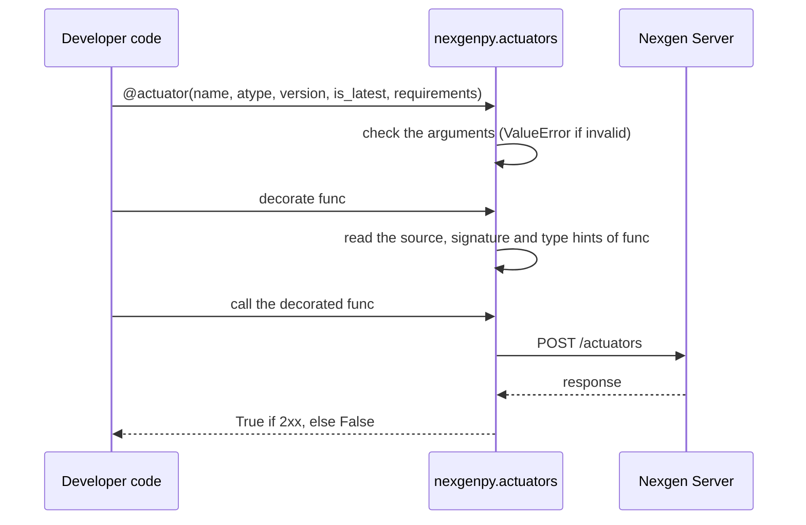
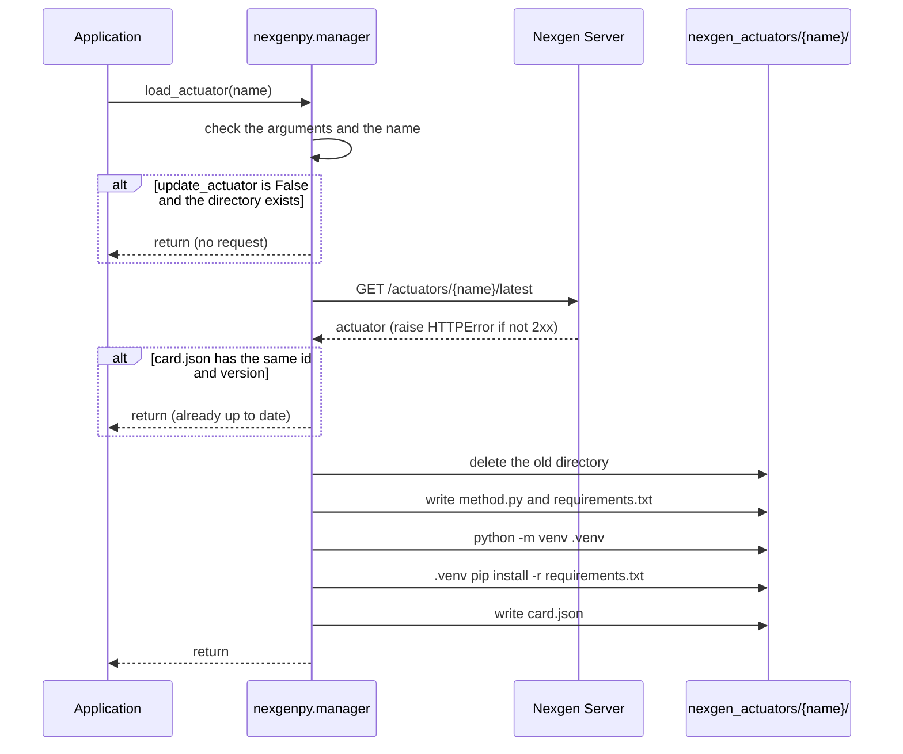
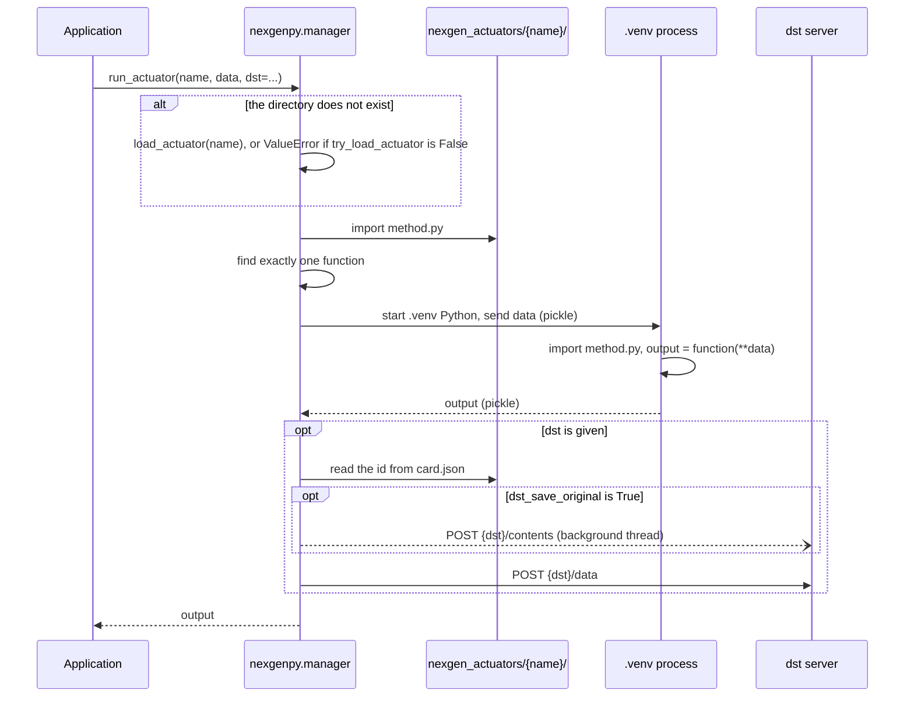

# Architecture

This document describes the modules of `nexgenpy`, the request flow for each operation, and the local files.

## Modules

| Module | Public API | Role |
|---|---|---|
| `nexgenpy/actuators.py` | `actuator` | Registers actuators on the server |
| `nexgenpy/manager.py` | `load_actuator`, `run_actuator`, `Actuator` | Downloads and runs actuators |

`nexgenpy/__init__.py` exports the four public names:

```python
from nexgenpy import Actuator, actuator, load_actuator, run_actuator
```

The library code imports one third-party package: `requests`.

## Register: `@actuator`



The decorator collects the actuator data when Python applies it to the function. The request goes to the server only when the code calls the decorated function. The call does not run the original function. It ignores the call arguments.

The request body has these fields:

| Field | Value |
|---|---|
| `name` | `name` |
| `version` | `version` |
| `actuator_type` | `atype` |
| `set_latest` | `is_latest` |
| `requirements` | `requirements`, or `[]` if it is `None` |
| `method` | The source of the function, from the `def` line. The decorator removes the decorator lines. |
| `method_args` | For each parameter: `{"type": str(annotation), "default": str(default)}`. A key is left out when the parameter has no type hint or no default, because the server accepts only string values. |

## Load: `load_actuator`



`load_actuator` writes `card.json` last. If the venv or pip step fails, the directory has no `card.json`. The next call then downloads the actuator again.

## Use: `run_actuator` and `Actuator`



`run_actuator` starts a new `.venv` process for each call. That process imports `method.py`, calls the function one time and stops.

### Worker processes of `Actuator`

The `Actuator` class starts its processes one time, in the constructor. These processes are the **workers**. The `workers` parameter sets their number. The default is 1.

- The constructor reads the function name from `method.py` with `ast`. It does not import `method.py` in the current process.
- Each worker imports `method.py` one time. Then it waits for calls.
- `run` sends `data` to a free worker through the stdin pipe of the worker. The worker sends the output back through its stdout pipe. Both directions use `pickle`.
- Each worker does one call at a time. If all workers are busy, the next call waits for a free worker.
- If the function raises an exception, the worker sends the traceback back and continues to run.
- If a worker stops during a call, the call raises `RuntimeError`. Then the `Actuator` starts a new worker in its place.
- `close` stops all workers. The `with` statement calls `close` at the end of the block. Python also calls `close` when the garbage collector frees the object, or when the program exits.

`Actuator.arun` is the `async` version of `run`. It waits for the worker and sends the `POST {dst}/data` request in separate threads with `asyncio.to_thread`. Thus they do not block the event loop. With `workers` greater than 1, many `arun` calls can run at the same time.

## Local directory layout

The default directory is `nexgen_actuators`, relative to the current working directory. Use the `actuators_dir` parameter to change it.

```text
nexgen_actuators/
└── {name}/
    ├── card.json
    ├── method.py
    ├── requirements.txt
    └── .venv/
```

`card.json` stores these fields from the server response:

```json
{
    "id": "…",
    "name": "keyword-extractor",
    "version": "1.0.0",
    "actuator_type": "coding",
    "method_args": {"text": {"type": "<class 'str'>"}},
    "latest": true,
    "created_at": "…",
    "updated_at": "…"
}
```

`run_actuator` reads `id` from `card.json` and sends it as `actuator_id` in each data item.

## The actuator environment

`load_actuator` makes a virtual environment in `{name}/.venv` with the Python that runs `nexgenpy`. Then it installs `requirements.txt` into that environment.

`run_actuator` and `Actuator` run the function in a separate process, with the Python of `{name}/.venv`. Thus the function can import each package in `requirements.txt`. The environment of your application does not need these packages.

The input data and the output go between the two processes with `pickle`. This has three results:

- Each value in `data` must be an object that `pickle` can serialize.
- The output must be an object that `pickle` can serialize.
- The current process must be able to import the class of the output. For example, a NumPy array as output needs NumPy in the environment of your application too.

Return built-in types, for example `dict`, `list` and `str`, to prevent these problems. See [Writing actuators](writing-actuators.md#5-return-a-json-compatible-value).

`run_actuator` also imports `method.py` in the current process to find the function name. This step runs the module-level code of `method.py`. For a `method.py` from the `@actuator` decorator, this code is only the `def` statement. `Actuator` does not do this step.

The `print()` output of the function does not go to the stdout of your application. The library logs it on the `nexgenpy.manager` logger. See [Configuration](configuration.md#logging).

## Error behavior

| Operation | Condition | Result |
|---|---|---|
| `@actuator(...)` | An argument has a wrong type or value | `ValueError` |
| decorated call | The request fails, or the server returns a status that is not 2xx | Logs a warning, returns `False` |
| `load_actuator` | An argument is invalid, or the name is not a plain directory name | `ValueError` |
| `load_actuator` | The server returns a status that is not 2xx | `requests.HTTPError` |
| `load_actuator` | The request cannot connect or times out | `requests.RequestException` |
| `load_actuator` | The venv or pip step fails | `subprocess.CalledProcessError` |
| `run_actuator`, `Actuator` | An argument is invalid | `ValueError` |
| `run_actuator`, `Actuator` | The actuator is not local and `try_load_actuator=False` | `ValueError` |
| `run_actuator`, `Actuator` | `method.py` does not define exactly one function | `ValueError` |
| `run_actuator`, `Actuator` | `{name}/.venv` has no Python interpreter | `FileNotFoundError` |
| `Actuator` | A worker cannot import `method.py` | `RuntimeError` |
| `Actuator.run` | The `Actuator` is closed | `RuntimeError` |
| `run_actuator`, `Actuator.run` | The actuator function raises an exception | `RuntimeError` with the traceback of the function |
| `run_actuator`, `Actuator.run` | `pickle` cannot serialize the output | `RuntimeError` |
| `run_actuator`, `Actuator.run` | The actuator process stops before it sends the output | `RuntimeError`. `Actuator` starts a new worker. |
| `run_actuator`, `Actuator.run` | `pickle` cannot serialize a value in `data` | The exception of `pickle` |
| `run_actuator`, `Actuator.run` | The current process cannot import the class of the output | `ModuleNotFoundError` |
| `run_actuator`, `Actuator.run` | `POST {dst}/data` returns a status that is not 2xx | Logs a warning, returns the output |
| `run_actuator`, `Actuator.run` | `POST {dst}/data` cannot connect or times out | `requests.RequestException` |
| content upload | Any error | Logs a warning. The background thread does not raise. |

`Actuator.arun` raises the same exceptions as `Actuator.run`.
